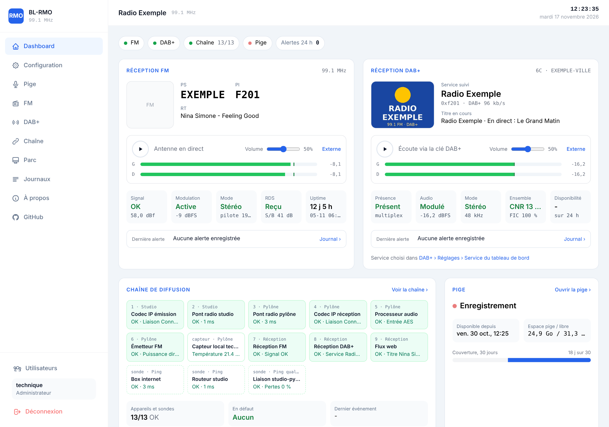
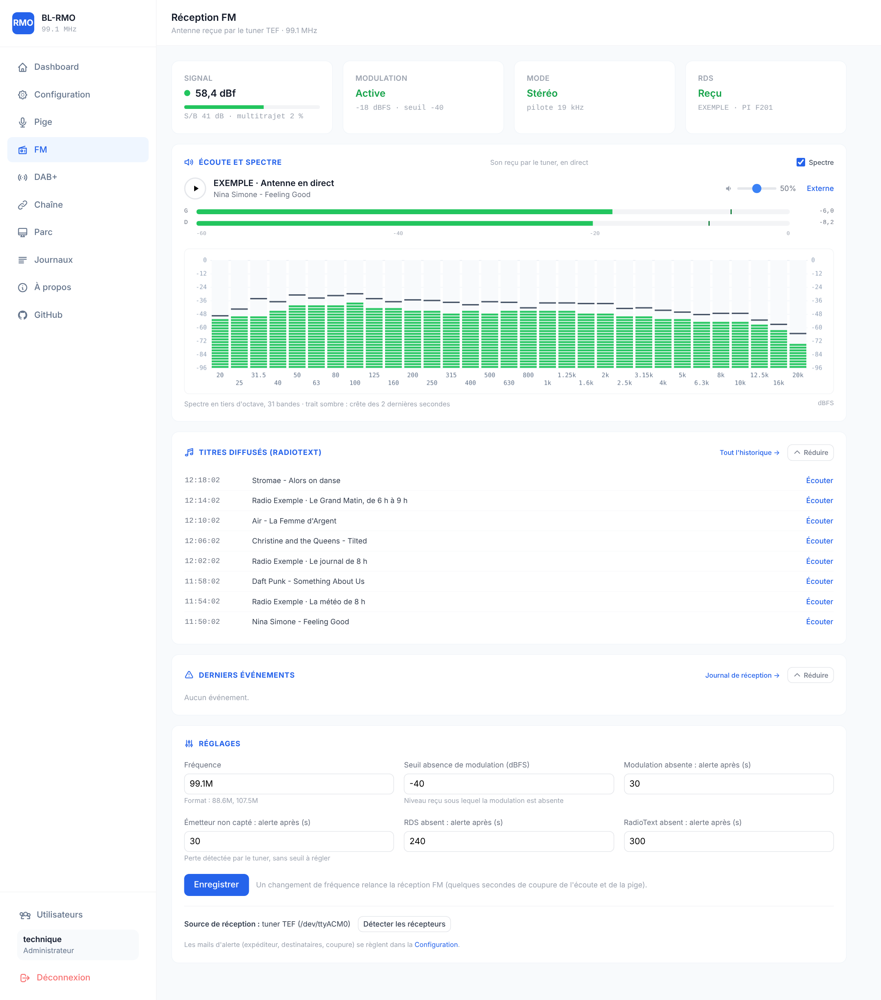
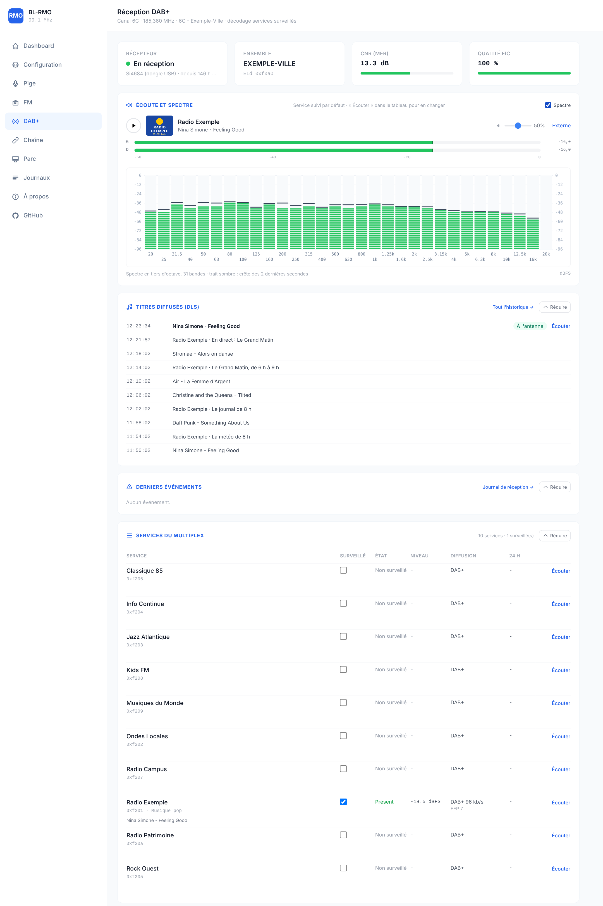
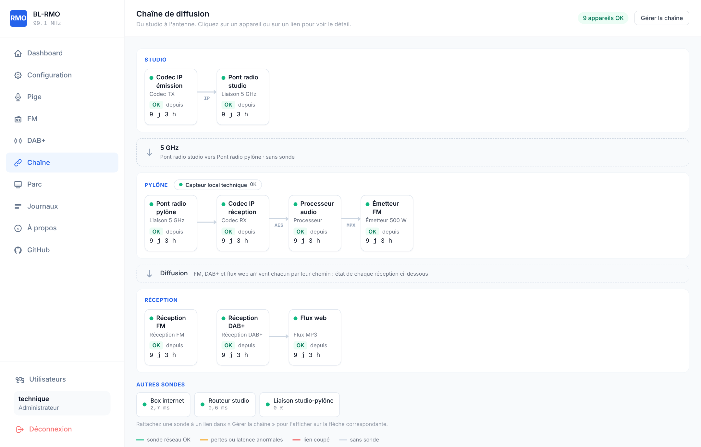
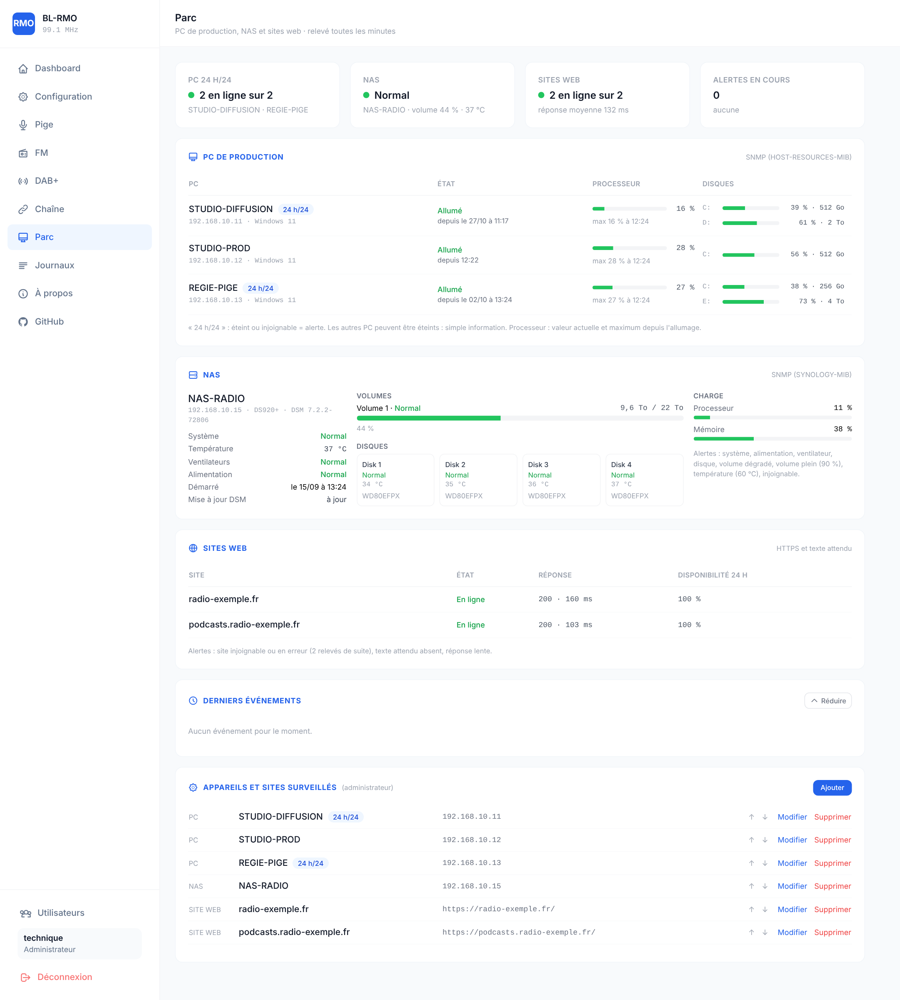

# 📻 BL-RMO

**Radio Monitoring**, formerly FM-Monitor. · 🇫🇷 [Version française](README.md)


**Open source monitoring for an FM and DAB+ radio station.** A mini PC, a [Headless TEF Lite SE](https://github.com/FMDX-org/Headless-TEF-lite-SE) tuner, a DAB+ receiver and an antenna are enough to:

- **monitor FM and DAB+ reception**: what actually comes out of the antenna (signal, modulation, RDS, multiplex, services, DLS);
- **monitor the broadcast chain**: every device, from studio to transmitter, through SNMP, network probes, syslog and traps;
- **monitor the station's IT assets**: PCs, NAS and websites;
- **listen to the broadcast** from any browser (FM, DAB+, web stream);
- **keep a 30-day logger**, linked to the alerts.

A mail goes out for every failure and every restoration, and each alert keeps its audio clip.

The interface and the alert mails are available in **French and English**: one setting for the whole of BL-RMO, in System › General.



<table>
  <tr>
    <td width="50%"><a href="docs/captures/fm.png"></a><br><b>FM reception</b>: signal, modulation, RDS, spectrum and RadioText history</td>
    <td width="50%"><a href="docs/captures/dab.png"></a><br><b>DAB+ reception</b>: multiplex, CNR and FIC, listening, DLS, services</td>
  </tr>
  <tr>
    <td width="50%"><a href="docs/captures/chain.png"></a><br><b>Broadcast chain</b>: from studio to antenna, device by device</td>
    <td width="50%"><a href="docs/captures/park.png"></a><br><b>Assets</b>: the station's PCs, NAS and websites</td>
  </tr>
</table>

<sub>Screenshots taken on a demo instance (French interface): the station "Radio Exemple", its devices and addresses are fictional.</sub>

---

## 🧭 Project direction

**Why BL-RMO?** The software used to be called FM-Monitor. It now monitors FM and DAB+ reception and the whole broadcast chain, so it became BL-RMO, for "Radio Monitoring". Folder `~/bl-rmo`, services `bl-rmo*`, address `bl-rmo.local`: an existing installation moves to the new names with the migration script (see [Moving from FM-Monitor to BL-RMO](#moving-from-fm-monitor-to-bl-rmo)).

BL-RMO now follows **a single direction**, and it is the only configuration developed and tested:

> **a Linux mini PC + a Headless TEF Lite SE tuner + an FM antenna**
> to monitor FM reception and the broadcast chain, with an FM off-air feed and a logger.

The Headless TEF Lite SE gives professional-grade reception: the tuner demodulates the signal and decodes RDS itself, and BL-RMO receives native RF measurements (dBf, signal-to-noise ratio, multipath).

### End-of-life features

The following features are **no longer developed**. They are still present in version 0.8 for existing installations, but will be removed in a future version:

| Feature | Why |
|---|---|
| FM reception with an **RTL-SDR** dongle (rtl_fm, GNU Radio) | Lower reception quality than the TEF; two processing chains to maintain |
| **MPX analysis** (deviation, pilot, subcarriers, MPX SNR) | Real but limited value with an RTL-SDR dongle; not the chosen direction |
| **Docker** installation | Never validated in production; access to the USB tuner and the syslog/trap ports is awkward there |

If you use one of these modes, version 0.8 keeps working. The instructions remain in the [appendix](#appendix-rtl-sdr-mode-and-mpx-analysis-end-of-life).

### What about the RTL-SDR?

The RTL-SDR dongle comes back in another role: **a second tuner dedicated to DAB+**, alongside the TEF for FM. This is the continuation of BL-DMO ([dabplus-monitor](https://github.com/LyonelB/dabplus-monitor)), now part of BL-RMO.

---

## ✨ Features

### 📡 FM reception (Headless TEF Lite SE)
- **Native RF measurements**: level in dBf, signal-to-noise ratio, multipath, frequency offset
- **Signal presence** measured from the tuner's frame rate, independent of the audio
- **Missing modulation** (carrier present, silent programme), **RDS** and **RadioText** alerts
- **L/R audio levels** measured continuously, **stereo or mono** from the tuner's pilot indicator
- **RDS** decoded by the tuner: PS, RadioText, PI code; station logo through [rds-station-db](https://github.com/LyonelB/rds-station-db)

### 📶 DAB+ reception (optional, RTL-SDR dongle or Si468x dongle)
- **Ensemble**: SNR, FIC quality, gain, identifier; alert when the ensemble degrades
- **One watched station**, chosen in the Settings tab of the DAB+ page: audio levels, DLS, bitrate, 24 h availability; **station missing from the multiplex** and **silence** alerts; the other services of the multiplex are counted in the Ensemble tile
- **Listening** to the station from the DAB+ page (automatic stop after 15 min, like FM), slideshow shown while listening
- DAB+ alerts by mail and in the **Log** tab of the DAB+ page, with a link to the logger
- Separate `bl-rmo-dab` service: a welle-cli or dongle crash affects neither the interface nor FM
- **Si468X Headless dongle** (trial, Skyworks Si4684 chip) instead of the RTL-SDR dongle and welle-cli: same interface, CNR (MER) and FIC quality from the chip, one service decoded at a time, almost no processor load; band III scan from the DAB+ page
- **"Watched station only" decoding** (recommended): only the watched station is decoded, continuously, for the load of a single decoder; the ensemble and the presence of all services are still monitored. "All services continuously" takes more than two cores (welle-cli re-encodes each service to MP3); the carousel only listens to each service for 10 s per round

### 🔊 Off-air feed
- **Listening to the broadcast** in the browser, Icecast2 MP3 128 kbps stream
- **Public mode** `/public`: dashboard without authentication

### 🎙️ Audio logger
- **One logger per reception**, in the **Logger** tab of the FM and DAB+ pages: the FM broadcast and the watched DAB+ station, continuously, as MP3 segments (`bl-rmo-pige` service, independent of the application), about 1.4 GB per day per logger; adjustable retention, logger can be stopped and restarted
- The DAB+ logger follows the watched station: changing station changes what it records, existing recordings are kept until the end of their retention; no watched station, no logger
- **Listening and clip**: date, start time, end time, playback and MP3 download without re-encoding
- **Clips of the last 10 FM alerts**, from 30 s before the alert to 30 s after the restoration, kept after they leave the logger and played in the same player
- Each alert and each chain event opens the logger at the right moment and starts playback

### 🔗 Broadcast chain
- **Overview** from studio to antenna: status of each device and each link, since when, details in one click
- **SNMP v1, v2c, v3** (read-only), ping, TCP, web page, Icecast; thresholds and expected values
- **Listened audio stream** (MP3, AAC web stream...): BL-RMO listens to it for a few seconds at each reading, like a listener: audio received, level, prolonged silence, current title, listeners and bitrate when the Icecast status page is public; tile to place in the Reception block, next to FM and DAB+
- **Presets**: BW Broadcast TX V3, Deva DB91-TX / DB91-RX, Sound4 PULSE / IMPACT
- **Network probes** (ping bursts: loss, latency, jitter) attached to links
- **History charts**, mail alerts with the faulty values, ZIP export
- **Overview**, **Log** (alerts and state changes, netwatch events, syslog messages and traps), **Devices** and **Settings** tabs

### 🖥️ Assets (PCs, NAS, websites)
- **Windows PCs** over SNMP: on or off and since when, processor (current value and maximum since power-on), disk usage; "24/7": off or restarted = alert, otherwise information only
- **Synology NAS** over SNMP (v2c or v3): system, power supply, fans, temperature, disks, volumes, DSM update
- **Websites**: HTTPS response, expected text, response time, 24 h availability
- SNMP on a Windows 10 or 11 PC: `install/windows/activer-snmp-bl-rmo.ps1` (PowerShell as administrator), read-only, restricted to the BL-RMO address
- **Status**, **Log** (events of the last 90 days, filters, CSV export) and **Devices** tabs

### 📜 Logs and traps
- **Syslog server** UDP 514 (`bl-rmo-syslog` service): the station's devices send their logs to BL-RMO
- **SNMP traps** UDP 162, decoded, with an immediate reading of the device
- **Cleaned-up reading** and **hidden messages** (known noise), shown again with a checkbox
- In the **Log** tab of the Chain page; rules and forwarding help in its **Settings** tab

### 🔔 Alerts
- **Mail** on failure and on restoration, for reception as well as for the chain; the station is named by its PS on FM and by the service name on DAB+
- **Mails in the language of BL-RMO** (French or English)
- **Mails per alert type**, to tick in the Settings tab of the FM and DAB+ pages; an unticked alert is still recorded in the log
- **History** of alerts in an SQLite database, each linked to the logger
- **Push webhook**: real-time JSON data to an external URL

### 👥 Accounts and roles
- **Viewer**: sees and listens; **Operator**: exports and records; **Administrator**: sets everything
- Access control checked server-side on every route

### 🌐 Web interface
- **Dashboard** at a glance: FM and DAB+ reception (player, level meter, indicators, last alert), complete broadcast chain with its probes, logger status
- **One menu per domain**: Dashboard, FM, DAB+, Chain, Assets and System; each page groups in tabs the live status, the log, the logger and the settings of its domain
- **System**: mails, network, language and DAC+ volume (General), accounts and roles (Accounts), log of BL-RMO and its services (BL-RMO log), backup and restore
- **French or English**: one setting for the whole of BL-RMO (System › General); alert mails follow the same language
- Full configuration from the browser
- **Responsive**: smartphone and tablet
- **Local access** through `https://bl-rmo.local` (Nginx + mDNS)

---

## 🔧 Hardware

| Item | Reference | Notes |
|---|---|---|
| Computer | Linux mini PC | Reference: Debian 13 (Trixie) on an x86 mini PC |
| Tuner | [Headless TEF Lite SE](https://github.com/FMDX-org/Headless-TEF-lite-SE) (FMDX.org) | TEF668X V205 (TEF6687 recommended), separate AM and FM inputs, digital audio over USB, [FM-DX-Tuner](https://github.com/kkonradpl/FM-DX-Tuner) firmware |
| Antenna | Outdoor FM antenna | Well clear: BL-RMO listens like a listener |
| Cable | USB **data** cable | A "charge only" cable does not carry the serial port |
| DAB+ (optional) | RTL-SDR dongle + band III antenna | NooElec NESDR SMArTee or SMArt (R820T2 tuner) recommended for 24/7 use (the RTL-SDR Blog V4 showed USB instabilities). See [DAB+ dongle tuning](#dab-dongle-tuning) |

Under Linux the tuner shows up as a serial port (`/dev/ttyACM0`, XDR protocol) and a sound card (`hw:Tuner`). It is recognised by its USB identifier `1209:6687`: if `/dev/ttyACM0` points to another device (a DAB+ dongle plugged in next to it), BL-RMO opens the TEF's stable port (`/dev/serial/by-id/...`).

**On trial**: Si468X Headless DAB+ dongle (Skyworks Si4684 chip, serial control and USB sound card `hw:DAB`, identifier `1209:468f`), instead of the RTL-SDR dongle and welle-cli (DAB+ page, Settings tab, "Receiver"): monitoring of one service and listening, with the same interface. One service decoded at a time; the other services of the multiplex are still monitored (presence). When it is not used as a receiver, it scans band III (Receivers block).

---

## 🚀 Installation

### ⚡ Automatic installation

> ⚠️ **Good practice**: inspect a remote script before running it:
> ```bash
> curl -sSL https://raw.githubusercontent.com/LyonelB/BL-RMO/main/install.sh -o install.sh
> less install.sh
> bash install.sh
> ```

The script installs the dependencies, sets up Icecast2, Nginx and the certificates, then the BL-RMO services (application, logger, logs).

### 📡 Tuner setup

```bash
# Plug in the tuner (USB data cable), then check:
ls /dev/ttyACM0
aplay -l | grep Tuner

# Serial port access for the service user
sudo usermod -a -G dialout $USER
```

Then, in the interface: **FM** page, **Settings** tab, **"Detect receivers"** button, **TEF668X** source. The matching section of `config.json`:

```json
"tef": {
    "enabled": true,
    "serial_port": "/dev/ttyACM0",
    "alsa_device": "hw:Tuner",
    "signal_threshold_dbf": 20.0,
    "modulation_threshold_dbfs": -40.0
}
```

### 🌍 Language

In **System**, **General** tab, choose **Français** or **English**. The setting applies to the whole of BL-RMO, for all accounts, and alert mails follow it. It is saved in `config.json`:

```json
"ui": { "language": "en" }
```

Translations live in `i18n/en.json`: the French text is the key, the English text the value. A missing entry stays in French.

### 🎙️ Services

`install.sh` installs them all. On an existing installation, the logger and the logs are added like this:

```bash
cd ~/bl-rmo
sudo bash install/build/65-pige.sh     # 30-day logger (bl-rmo-pige)
sudo bash install/build/66-syslog.sh   # logs UDP 514 and traps UDP 162 (bl-rmo-syslog)
sudo BUILD_WELLE=1 bash install/build/67-dab.sh   # DAB+ reception (bl-rmo-dab) and welle-cli build
```

DAB+ reception stays idle until a receiver is chosen in the **Settings** tab of the **DAB+** page (administrator): receiver, channel, watched station and thresholds are set there.

#### DAB+ dongle tuning

- **Decoding**: "Watched station only".
- **Gain**: a fixed gain syncs much faster than automatic. With a NESDR SMArTee (R820T2) near FM transmitters, **14.4 dB** removed the converter overloads ("ADC overload" in `logs/welle-cli.log`) while keeping an SNR of about 15 dB. To check a setting, count the overloads over 30 s:
  ```bash
  { timeout 30 tail -n0 -f ~/bl-rmo/logs/welle-cli.log; true; } | grep -c overload
  ```
  Keep the highest gain that stays at 0 overloads, with an SNR above about 10 dB.
- **FM band-stop filter** (optional, around twenty euros, e.g. the RTL-SDR Blog one) between the antenna and the dongle: it attenuates nearby FM transmitters and lets you raise the gain without overloading. Choose a model that passes DC without shorting it (the SMArTee bias-tee powers the antenna with 4.5 V).

| Service | Role | Ports |
|---|---|---|
| `bl-rmo` | Web application, FM reception, chain monitoring | 5000 (behind Nginx 80/443) |
| `bl-rmo-pige` | Logger recording | reads Icecast 8000 |
| `bl-rmo-syslog` | Reception of logs and traps | UDP 514, UDP 162 |
| `bl-rmo-dab` | DAB+ reception (drives welle-cli) | welle-cli 7979 (welle-cli web interface, reachable on the network) |
| `icecast2` | Broadcast audio stream (off-air feed and logger) | 8000 |

Chain SNMP monitoring uses `snmpget`: `sudo apt install snmp` if it is not already there.

### Moving from FM-Monitor to BL-RMO

An installation made before version 0.10 still uses the `~/fm-monitor` folder and the `fm-monitor*` services. The migration script moves everything to the new names, without touching the data (logger, clips, databases, `config.json`):

```bash
cd ~/fm-monitor
bash install/migrate-to-bl-rmo.sh            # inventory, changes nothing
bash install/migrate-to-bl-rmo.sh --apply    # migration (about 5 min of downtime)
bash ~/bl-rmo/install/migrate-to-bl-rmo.sh --rollback   # roll back if needed
```

It renames the folder and the services, updates Nginx, the certificates, sudoers, the machine name (`bl-rmo.local`) and the NetBIOS announcement. The old names keep working during the transition: `~/fm-monitor` points to `~/bl-rmo`, `bl-fmo.local` still answers and `systemctl restart fm-monitor` restarts `bl-rmo`. The IP address does not change.

### 🔄 Update

```bash
cd ~/bl-rmo
bash update.sh
```

### ✉️ Alert mails

In **System**, **General** tab, fill in the sender and the recipients. With Gmail, use an [app password](https://myaccount.google.com/apppasswords), then the **Test email** button.

---

## 📂 Project structure

```
bl-rmo/
├── app.py              # Flask application (routes, API, access control)
├── version.py          # Version number
├── monitor.py          # Reception engine (tuner, RDS, alerts)
├── tef_driver.py       # TEF668X tuner driver (XDR protocol)
├── tef_audio_analyzer.py # Audio analysis (levels, spectrum, SNR)
├── usb_receivers.py    # Connected USB receivers (TEF, Si468x dongle, RTL-SDR dongles)
├── si468x.py           # Si468x DAB+ dongle: serial protocol, band III scan
├── si468x_server.py    # Si468x DAB+ dongle served with the welle-cli API (DAB+ reception)
├── chain_probe.py      # Chain monitoring (SNMP, probes, events)
├── park.py             # Assets: Windows PCs, Synology NAS, websites
├── audio_defects.py    # Audio defects: dropouts, clicks, crackles
├── pige.py             # 30-day logger (recorder and export)
├── pige_archive.py     # Audio clips of the latest alerts
├── syslog_server.py    # Syslog and trap reception service
├── snmp_traps.py       # SNMP trap decoding and translation
├── syslog_clean.py     # Cleaned-up reading and hidden messages
├── auth.py             # Accounts, roles, authentication
├── email_alert.py      # Alert mails
├── i18n.py             # Translation: chosen language, i18n/en.json dictionary
├── database.py         # SQLite database (history, alerts)
├── install.sh          # Full installation
├── install/build/      # Installation steps (logger, logs...)
├── install/windows/    # SNMP activation script for Windows PCs
├── update.sh           # Update
├── i18n/               # Translations (en.json)
├── templates/          # Pages: dashboard, FM, DAB+, chain, assets, system...
└── static/             # CSS and JS
```

End of life (see [Project direction](#-project-direction)): `mpx_analyzer.py`, `wfm_stereo.py`, the RTL-SDR part of `monitor.py`, `Dockerfile`, `docker-compose.yml`, `docker/`.

---

## 📖 Documentation

The **About** page built into the interface explains how BL-RMO works, the Headless TEF Lite SE tuner, FM broadcasting and RDS, DAB+, and the services and their ports.

---

## 🛠️ Troubleshooting

### The tuner is not detected

```bash
lsusb | grep 1209:6687        # is the tuner seen on USB?
ls -l /dev/ttyACM0            # is the serial port there?
groups | grep dialout         # does the user have access to the serial port?
aplay -l | grep Tuner         # is the sound card there?
```

Nothing in `lsusb`: change the cable (data cable) or the USB port.

### No audio in the off-air feed or the logger

The tuner's sound card can only be opened by one program at a time. Check that no other software uses `hw:Tuner`, then: `sudo systemctl restart bl-rmo`.

### Mails are not sent

1. Check the settings in the Settings tab of the FM and DAB+ pages, and in System
2. Use the **Test email** button
3. Read the logs: `sudo journalctl -u bl-rmo -n 50`

### Device logs do not arrive

```bash
sudo systemctl status bl-rmo-syslog
sudo journalctl -u bl-rmo-syslog -n 20
```

On the device, the syslog server must be the **IP address** of BL-RMO (not `bl-rmo.local`), port 514, UDP.

---

## 🗺️ Roadmap

### Done
- [x] v0.3 to v0.7: Icecast2, SSL, automatic installation, alerts, local access, public mode, webhook, mobile interface
- [x] v0.8.0: TEF668X tuner, 24 h logger, broadcast chain, logs and traps, accounts and roles
- [x] v0.9.0: new name BL-RMO, logs in three tabs
- [x] DAB+ reception (continuation of BL-DMO), validated on site
- [x] FM, DAB+, chain and logger dashboard
- [x] Navigation by domain: FM, DAB+, Chain, Assets and System, each with its log, logger and settings
- [x] One logger per reception: FM and watched DAB+ station
- [x] Site sensors (temperature, humidity... of a shelter), outside the signal path
- [x] English version of the interface and the mails

### Next
- [ ] Dante monitoring, free and self-hosted, in the spirit of Dante Director: device discovery (mDNS), status, clock, audio subscriptions, change log and alerts. Lead: the [netaudio](https://github.com/chris-ritsen/network-audio-controller) library

### Next release
- [ ] Removal of RTL-SDR FM reception, MPX analysis and Docker

### To do
- [ ] Alert when switching to mono
- [ ] welle-monitor: port the changes of the next welle.io version

### On hold
- [ ] Incidents page: grouping of reception and broadcast alerts, probable cause, timeline
- [ ] Heartbeat to an external service (healthchecks.io...): an alert even if BL-RMO or the server goes down
- [ ] Frozen audio alert (stuck loop, fixed tone) and RadioText unchanged for too long
- [ ] AES67 probe: listen to the console output on the Dante network
- [ ] BL-DMO ([dabplus-monitor](https://github.com/LyonelB/dabplus-monitor)): repository archived, possible deletion later

---

## 📄 License

MIT: free to use, modify and distribute.

---

## 🙏 Credits

- [Headless TEF Lite SE](https://github.com/FMDX-org/Headless-TEF-lite-SE) (FMDX.org): TEF668X USB tuner, [FM-DX-Tuner](https://github.com/kkonradpl/FM-DX-Tuner) firmware
- [welle.io](https://github.com/AlbrechtL/welle.io) (Albrecht Lohofener, Matthias P. Braendli) and its fork [welle-monitor](https://github.com/LyonelB/welle-monitor): DAB+ decoding
- mc_popa: Si468X Headless DAB+ dongle (STM32, Si4684) and its firmware
- [Icecast2](https://icecast.org): streaming server
- [Net-SNMP](http://www.net-snmp.org): SNMP tools
- [Radio Browser](https://www.radio-browser.info): station database
- [redsea](https://github.com/windytan/redsea) and [RTL-SDR Blog](https://www.rtl-sdr.com): RDS decoding and drivers for the RTL-SDR mode (end of life)

---

## Appendix: RTL-SDR mode and MPX analysis (end of life)

<details>
<summary>Instructions kept for existing installations</summary>

These features are no longer developed and will be removed in a future version.

### RTL-SDR dongles

| Dongle | Chip | Notes |
|--------|------|-------|
| RTL-SDR Blog V3 | RTL2832U + R820T2 | Standard drivers |
| RTL-SDR Blog V4 | RTL2832U + R828D | Needs the [official fork](https://github.com/rtlsdrblog/rtl-sdr-blog) |
| Nooelec NESDR SMArt | RTL2832U + R820T2 | Standard drivers |

### RTL-SDR Blog V4 drivers

```bash
echo 'blacklist dvb_usb_rtl28xxu' | sudo tee /etc/modprobe.d/blacklist-rtl.conf
sudo modprobe -r dvb_usb_rtl28xxu 2>/dev/null
sudo apt install -y git cmake libusb-1.0-0-dev build-essential pkg-config
git clone https://github.com/rtlsdrblog/rtl-sdr-blog
cd rtl-sdr-blog && mkdir build && cd build
cmake .. -DINSTALL_UDEV_RULES=ON
make -j$(nproc) && sudo make install && sudo ldconfig
sudo cp ~/rtl-sdr-blog/rtl-sdr.rules /etc/udev/rules.d/
sudo udevadm control --reload-rules && sudo udevadm trigger
rtl_test -t
```

### Going back to RTL-SDR mode

Set `"enabled": false` in the `tef` section of `config.json`, then `sudo systemctl restart bl-rmo`.

### MPX analysis (RTL-SDR mode only)

Peak and RMS deviation, L/R levels, 19 kHz pilot, 38 kHz stereo subcarrier, 57 kHz RDS subcarrier, MPX power, SNR, over-deviation alert.

### Differences between the two modes

| Feature | RTL-SDR | Headless TEF Lite SE |
|---|---|---|
| Signal level | dBFS, computed from audio | dBf, native RF measurement |
| RDS | redsea on the MPX | Decoded by the tuner |
| MPX analysis | Yes | No |
| Stereo / mono | From the pilot | From the RDS MS bit |
| L/R levels, audio SNR | Yes | Yes |
| Reception quality | Fair | Excellent |

### Docker (never validated)

```bash
docker compose up -d
```

</details>
