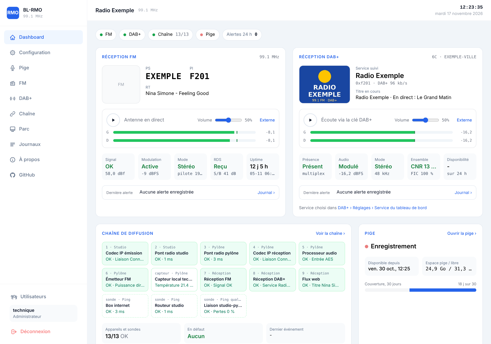
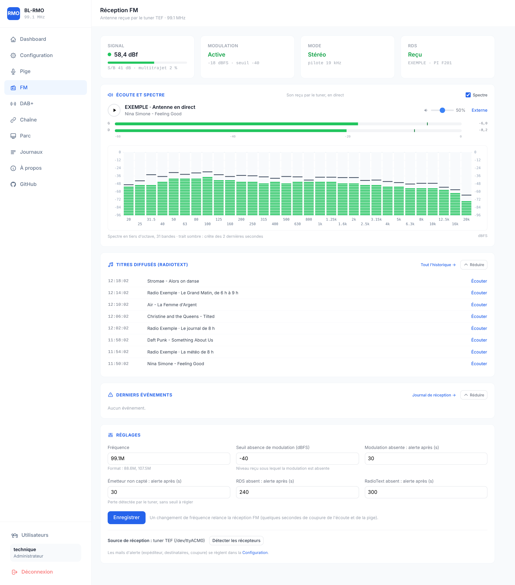
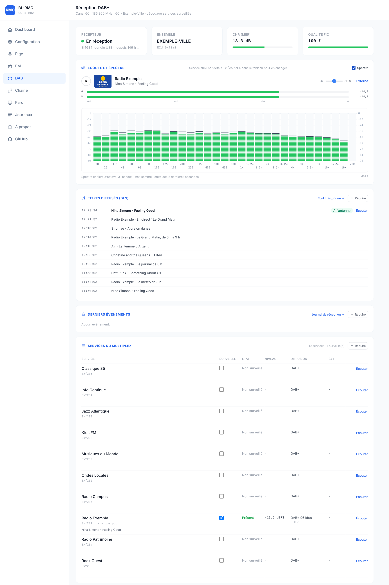
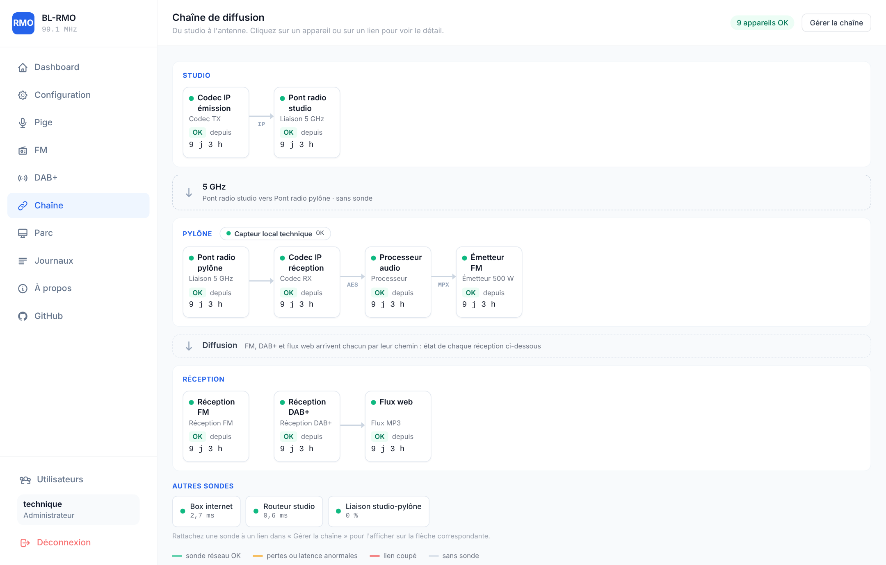
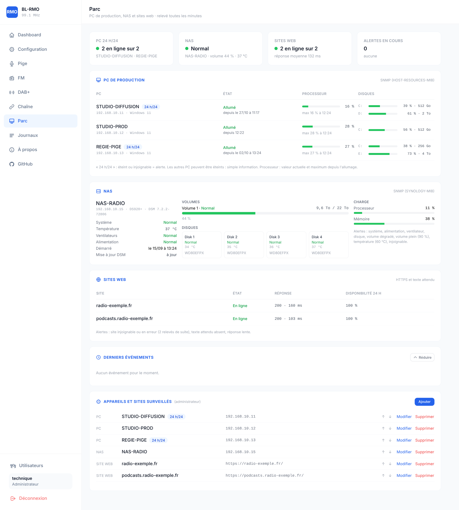

# 📻 BL-RMO

**Radio Monitoring**, anciennement FM-Monitor. · 🇬🇧 [English version](README.en.md)


**Système open source de supervision d'une radio FM et DAB+.** Un mini-PC, un tuner [Headless TEF Lite SE](https://github.com/FMDX-org/Headless-TEF-lite-SE), un récepteur DAB+ et une antenne suffisent pour :

- **surveiller la réception FM et DAB+** : ce qui sort réellement de l'antenne (signal, modulation, RDS, multiplex, services, DLS) ;
- **surveiller la chaîne de diffusion** : chaque appareil, du studio à l'émetteur, par SNMP, sondes réseau, journaux syslog et traps ;
- **surveiller le parc** de la radio : PC, NAS et sites web ;
- **écouter l'antenne** depuis n'importe quel navigateur (FM, DAB+, flux web) ;
- **garder une pige** de 30 jours, reliée aux alertes.

Une alerte mail part à chaque panne et à chaque rétablissement, et chaque alerte garde son extrait audio.



<table>
  <tr>
    <td width="50%"><a href="docs/captures/fm.png"></a><br><b>Réception FM</b> : signal, modulation, RDS, spectre et historique RadioText</td>
    <td width="50%"><a href="docs/captures/dab.png"></a><br><b>Réception DAB+</b> : multiplex, CNR et FIC, écoute, DLS, services</td>
  </tr>
  <tr>
    <td width="50%"><a href="docs/captures/chain.png"></a><br><b>Chaîne de diffusion</b> : du studio à l'antenne, appareil par appareil</td>
    <td width="50%"><a href="docs/captures/park.png"></a><br><b>Parc</b> : PC, NAS et sites web de la radio</td>
  </tr>
</table>

<sub>Captures réalisées sur une instance de démonstration : la station « Radio Exemple », ses appareils et ses adresses sont fictifs.</sub>

---

## 🧭 Direction du projet

**Pourquoi BL-RMO ?** Le logiciel s'appelait FM-Monitor. Il surveille désormais la réception FM et DAB+ et toute la chaîne de diffusion : il devient BL-RMO, pour « Radio Monitoring ». Dossier `~/bl-rmo`, services `bl-rmo*`, adresse `bl-rmo.local` : une installation existante passe aux nouveaux noms avec le script de migration (voir [Passer de FM-Monitor à BL-RMO](#passer-de-fm-monitor-à-bl-rmo)).

BL-RMO suit désormais **une seule direction**, et c'est la seule configuration développée et testée :

> **un mini-PC Linux + un tuner Headless TEF Lite SE + une antenne FM**
> pour surveiller la réception FM, la chaîne de diffusion, offrir un retour FM et une pige.

Le Headless TEF Lite SE donne une réception de qualité professionnelle : le tuner démodule lui-même le signal et décode le RDS, et BL-RMO reçoit des mesures RF natives (dBf, rapport signal/bruit, trajets multiples).

### Fonctions en fin de vie

Les fonctions suivantes **ne sont plus développées**. Elles restent présentes dans la version 0.8 pour les installations existantes, mais seront retirées dans une prochaine version :

| Fonction | Pourquoi |
|---|---|
| Réception FM par dongle **RTL-SDR** (rtl_fm, GNU Radio) | Qualité de réception inférieure au TEF ; double chaîne de traitement à maintenir |
| **Analyse MPX** (déviation, pilote, sous-porteuses, SNR MPX) | Intérêt réel mais limité avec un dongle RTL-SDR ; ce n'est pas la direction retenue |
| Installation **Docker** | Jamais validée en production ; l'accès au tuner USB et aux ports syslog/traps s'y prête mal |

Si vous utilisez l'un de ces modes, la version 0.8 continue de fonctionner. Les instructions restent en [annexe](#annexe--mode-rtl-sdr-et-analyse-mpx-fin-de-vie).

### Et le RTL-SDR ?

Le dongle RTL-SDR revient dans un autre rôle : **second tuner dédié au DAB+**, en parallèle du TEF pour la FM. C'est la reprise de BL-DMO ([dabplus-monitor](https://github.com/LyonelB/dabplus-monitor)), désormais intégré à BL-RMO (en cours de validation).

---

## ✨ Fonctionnalités

### 📡 Réception FM (Headless TEF Lite SE)
- **Mesures RF natives** : niveau en dBf, rapport signal/bruit, trajets multiples, décalage de fréquence
- **Présence du signal** mesurée par la cadence des trames du tuner, indépendante du son
- **Absence de modulation** (porteuse présente, programme muet), alertes **RDS** et **RadioText**
- **Niveaux audio G/D** mesurés en continu, **stéréo ou mono** d'après l'indicateur de pilote du tuner
- **RDS** décodé par le tuner : PS, RadioText, code PI ; logo de la station via [rds-station-db](https://github.com/LyonelB/rds-station-db)

### 📶 Réception DAB+ (option, clé RTL-SDR ou dongle Si468x)
- **Ensemble** : SNR, qualité FIC, gain, identifiant ; alerte quand l'ensemble se dégrade
- **Une station suivie**, choisie dans l'onglet Configuration de la page DAB+ : niveaux audio, DLS, débit, disponibilité sur 24 h ; alertes **station absente du multiplex** et **silence** ; les autres services du multiplex sont comptés dans la tuile Ensemble
- **Écoute** de la station depuis la page DAB+ (arrêt automatique après 15 min, comme en FM), diaporama (slideshow) affiché pendant l'écoute
- Alertes DAB+ par mail et dans l'onglet **Journal** de la page DAB+, avec lien vers la pige
- Service indépendant `bl-rmo-dab` : un plantage de welle-cli ou de la clé ne touche ni l'interface, ni la FM
- **Dongle Si468X Headless** (essai, puce Skyworks Si4684) à la place de la clé RTL-SDR et de welle-cli : même interface, CNR (MER) et qualité FIC donnés par la puce, un seul service décodé à la fois, presque aucune charge processeur ; balayage de la bande III depuis la page DAB+
- **Décodage « Station suivie seulement »** (conseillé) : seule la station suivie est décodée, en continu, pour la charge d'un seul décodeur ; l'ensemble et la présence de tous les services restent suivis. « Tous les services en continu » occupe plus de deux cœurs (welle-cli réencode chaque service en MP3) ; le carrousel n'écoute chaque service que 10 s par tour

### 🔊 Retour FM
- **Écoute de l'antenne** dans le navigateur, flux Icecast2 MP3 128 kbps
- **Mode public** `/public` : tableau de bord sans authentification

### 🎙️ Pige audio
- **Une pige par réception**, dans l'onglet **Pige** des pages FM et DAB+ : l'antenne FM et la station DAB+ suivie, en continu, en segments MP3 (service `bl-rmo-pige`, indépendant de l'application), environ 1,4 Go par jour et par pige ; durée de conservation réglable, pige arrêtable et redémarrable
- La pige DAB+ suit la station suivie : changer de station change ce qu'elle enregistre, les enregistrements déjà faits restent jusqu'à la fin de leur conservation ; sans station suivie, pas de pige
- **Écoute et extrait** : date, heure de début, heure de fin, lecture et téléchargement en MP3 sans réencodage
- **Extraits des 10 dernières alertes FM**, de 30 s avant l'alerte à 30 s après le rétablissement, conservés après la sortie de la pige et lus dans le même lecteur
- Chaque alerte et chaque événement de la chaîne ouvre la pige au bon moment et lance la lecture

### 🔗 Chaîne de diffusion
- **Synoptique** du studio à l'antenne : état de chaque appareil et de chaque lien, depuis quand, détail en un clic
- **SNMP v1, v2c, v3** (lecture seule), ping, TCP, page web, Icecast ; seuils et valeurs attendues
- **Flux audio écouté** (flux web MP3, AAC...) : BL-RMO l'écoute quelques secondes à chaque relevé, comme un auditeur : son reçu, niveau, silence prolongé, titre en cours, auditeurs et débit si la page d'état Icecast est publique ; tuile à placer dans le bloc Réception, à côté de la FM et du DAB+
- **Préréglages** : BW Broadcast TX V3, Deva DB91-TX / DB91-RX, Sound4 PULSE / IMPACT
- **Sondes réseau** (rafales de pings : pertes, latence, gigue) rattachées aux liens
- **Historique en courbes**, alertes mail avec les valeurs en défaut, export ZIP
- Onglets **Synoptique**, **Journal** (alertes et changements d'état, événements netwatch, messages syslog et traps), **Appareils** et **Configuration**

### 🖥️ Parc (PC, NAS, sites web)
- **PC Windows**, par l'**agent BL-RMO** ou en SNMP : allumé ou éteint et depuis quand, processeur (valeur actuelle et maximum depuis l'allumage), occupation des disques ; « 24 h/24 » : éteint ou redémarrage = alerte, sinon simple information
- **NAS Synology** en SNMP (v2c ou v3) : système, alimentation, ventilateurs, température, disques, volumes, mise à jour DSM
- **Sites web** : réponse HTTPS, texte attendu, temps de réponse, disponibilité sur 24 h
- **Agent BL-RMO** (Windows 10 et 11, 64 bits) : un installeur à double-cliquer, `setup-agent-bl-rmo-x.y.z.exe`, dans les [versions de l'agent](https://github.com/LyonelB/BL-RMO/releases?q=agent&expanded=true). Il demande l'adresse de BL-RMO et le jeton du PC (Parc › Appareils, relevé « Agent BL-RMO »), installe l'agent comme tâche planifiée au démarrage et vérifie que BL-RMO reçoit le premier relevé. L'agent envoie ses relevés toutes les minutes ; les modules (système, Dante) se choisissent dans BL-RMO. Pas de SNMP à activer, aucun port ouvert sur le PC. Sources dans `agent/`, installeur construit par GitHub Actions
- SNMP sur un PC Windows 10 ou 11, sans agent : `install/windows/activer-snmp-bl-rmo.ps1` (PowerShell en administrateur), lecture seule, réservé à l'adresse de BL-RMO
- Onglets **État**, **Journal** (événements des 90 derniers jours, filtres, export CSV) et **Appareils**

### 🎚️ Dante
- **Appareils** du réseau Dante : en ligne ou absent, produit, adresse, latence, fréquence d'échantillonnage, canaux
- **Abonnements** : qui reçoit quoi, état de chaque abonnement (unicast, multicast, non résolu...)
- **Niveaux** : crête par canal au moment du relevé (une fois par minute), pour voir si un canal porte du signal ; aussi dans la liste des abonnements
- **Horloge** : leader d'horloge et sa source ; signalé si aucun leader, plusieurs, ou un autre que d'habitude
- **Référence** : un appareil ou un abonnement vu une fois puis disparu est signalé, jusqu'à ce qu'un administrateur prenne l'état actuel comme référence
- **Relevé par l'agent BL-RMO** d'un PC du réseau Dante, module Dante coché dans Parc › Appareils : lit le réseau avec [netaudio](https://github.com/chris-ritsen/network-audio-controller), en lecture seule, et envoie le relevé à BL-RMO toutes les minutes ; aucun port ouvert sur le PC. L'ancienne sonde en script PowerShell (`install/windows/installer-sonde-dante.ps1`) reste acceptée
- Première étape : visualisation. Alertes, journal et tuile du tableau de bord à venir

### 📜 Journaux et traps
- **Serveur syslog** UDP 514 (service `bl-rmo-syslog`) : les appareils de la radio envoient leurs journaux à BL-RMO
- **Traps SNMP** UDP 162 traduits en français, avec relevé immédiat de l'appareil
- **Lecture nettoyée** et **messages masqués** (bruit connu), réaffichables d'une case à cocher
- Dans l'onglet **Journal** de la page Chaîne ; règles et aide à l'envoi dans son onglet **Configuration**

### 🔔 Alertes
- **Mail** à la panne et au rétablissement, pour la réception comme pour la chaîne ; la station y est nommée par son PS en FM et par le nom du service en DAB+
- **Mails par type d'alerte** à cocher dans l'onglet Configuration des pages FM et DAB+ ; une alerte décochée reste enregistrée dans le journal
- **Historique** des alertes en base SQLite, chacune reliée à la pige
- **Push webhook** : données temps réel en JSON vers une URL externe

### 👥 Comptes et rôles
- **Lecteur** : consulte et écoute ; **Opérateur** : exporte et enregistre ; **Administrateur** : règle tout
- Contrôle d'accès vérifié côté serveur sur chaque route

### 🌐 Interface web
- **Tableau de bord** d'un seul coup d'œil : réception FM et DAB+ (lecteur, VU-mètre, indicateurs, dernière alerte), chaîne de diffusion complète avec ses sondes, état de la pige
- **Un menu par domaine** : Dashboard, FM, DAB+, Chaîne, Dante, Parc et Système ; chaque page regroupe en onglets l'état en direct, le journal, la pige et la configuration de son domaine
- **Système** : mails, réseau et volume DAC+ (Général), comptes et rôles (Comptes), journal de BL-RMO et de ses services (Journal BL-RMO), sauvegarde et restauration
- Configuration complète depuis le navigateur
- **Responsive** : smartphone et tablette
- **Accès local** via `https://bl-rmo.local` (Nginx + mDNS)
- **Français ou anglais** : un réglage pour tout BL-RMO (Système › Général), les mails d'alerte suivent la même langue

---

## 🔧 Matériel

| Élément | Référence | Notes |
|---|---|---|
| Ordinateur | Mini-PC Linux | Référence : Debian 13 (Trixie) sur mini-PC x86 |
| Tuner | [Headless TEF Lite SE](https://github.com/FMDX-org/Headless-TEF-lite-SE) (FMDX.org) | TEF668X V205 (TEF6687 recommandé), entrées AM et FM séparées, audio numérique par USB, firmware [FM-DX-Tuner](https://github.com/kkonradpl/FM-DX-Tuner) |
| Antenne | Antenne FM extérieure | Bien dégagée : BL-RMO écoute comme un auditeur |
| Câble | USB de **données** | Un câble « charge seule » ne laisse pas passer le port série |
| DAB+ (option) | Clé RTL-SDR + antenne bande III | NooElec NESDR SMArTee ou SMArt (tuner R820T2) conseillée pour un usage 24 h/24 (le RTL-SDR Blog V4 a montré des instabilités USB). Voir [Réglage de la clé DAB+](#réglage-de-la-clé-dab) |

Le tuner apparaît sous Linux comme un port série (`/dev/ttyACM0`, protocole XDR) et une carte son (`hw:Tuner`). Il est reconnu par son identifiant USB `1209:6687` : si `/dev/ttyACM0` désigne un autre appareil (dongle DAB+ branché à côté), BL-RMO ouvre le port stable du TEF (`/dev/serial/by-id/...`).

**En essai** : dongle DAB+ Si468X Headless (puce Skyworks Si4684, contrôle série et carte son USB `hw:DAB`, identifiant `1209:468f`), à la place de la clé RTL-SDR et de welle-cli (page DAB+, onglet Configuration, « Récepteur ») : surveillance d'un service et écoute, avec la même interface. Un seul service décodé à la fois ; les autres services du multiplex restent suivis (présence). Quand il ne sert pas de récepteur, il balaye la bande III (bloc Récepteurs).

---

## 🚀 Installation

### ⚡ Installation automatique

> ⚠️ **Bonne pratique** : avant d'exécuter un script distant, inspectez-le :
> ```bash
> curl -sSL https://raw.githubusercontent.com/LyonelB/BL-RMO/main/install.sh -o install.sh
> less install.sh
> bash install.sh
> ```

Le script installe les dépendances, configure Icecast2, Nginx et les certificats, puis les services de BL-RMO (application, pige, journaux).

### 📡 Mise en service du tuner

```bash
# Brancher le tuner (câble USB de données), puis vérifier :
ls /dev/ttyACM0
aplay -l | grep Tuner

# Accès au port série pour l'utilisateur du service
sudo usermod -a -G dialout $USER
```

Puis, dans l'interface : page **FM**, onglet **Configuration**, bouton **« Détecter les récepteurs »**, source **TEF668X**. La section correspondante de `config.json` :

```json
"tef": {
    "enabled": true,
    "serial_port": "/dev/ttyACM0",
    "alsa_device": "hw:Tuner",
    "signal_threshold_dbf": 20.0,
    "modulation_threshold_dbfs": -40.0
}
```

### 🎙️ Services

`install.sh` les installe tous. Sur une installation existante, la pige et les journaux s'ajoutent ainsi :

```bash
cd ~/bl-rmo
sudo bash install/build/65-pige.sh     # pige 30 jours (bl-rmo-pige)
sudo bash install/build/66-syslog.sh   # journaux UDP 514 et traps UDP 162 (bl-rmo-syslog)
sudo BUILD_WELLE=1 bash install/build/67-dab.sh   # réception DAB+ (bl-rmo-dab) et compilation de welle-cli
```

La réception DAB+ reste en veille tant qu'aucun récepteur n'est choisi dans l'onglet **Configuration** de la page **DAB+** (administrateur) : récepteur, canal, station suivie et seuils s'y règlent.

#### Réglage de la clé DAB+

- **Décodage** : « Services surveillés seulement », en cochant le ou les services à surveiller.
- **Gain** : un gain fixe synchronise bien plus vite que l'automatique. Avec une NESDR SMArTee (R820T2) près d'émetteurs FM, **14,4 dB** a supprimé les saturations du convertisseur (« ADC overload » dans `logs/welle-cli.log`) tout en gardant un SNR d'environ 15 dB. Pour vérifier un réglage, compter les saturations sur 30 s :
  ```bash
  { timeout 30 tail -n0 -f ~/bl-rmo/logs/welle-cli.log; true; } | grep -c overload
  ```
  Garder le gain le plus élevé qui reste à 0 saturation, avec un SNR au-dessus d'environ 10 dB.
- **Filtre coupe-bande FM** (option, une vingtaine d'euros, ex. celui de RTL-SDR Blog) entre l'antenne et la clé : il atténue les émetteurs FM proches et permet de remonter le gain sans saturer. Choisir un modèle qui laisse passer le courant continu sans le court-circuiter (le bias-tee de la SMArTee alimente l'antenne en 4,5 V).

| Service | Rôle | Ports |
|---|---|---|
| `bl-rmo` | Application web, réception FM, supervision de la chaîne | 5000 (derrière Nginx 80/443) |
| `bl-rmo-pige` | Enregistrement de la pige | lit Icecast 8000 |
| `bl-rmo-syslog` | Réception des journaux et des traps | UDP 514, UDP 162 |
| `bl-rmo-dab` | Réception DAB+ (pilote welle-cli) | welle-cli 7979 (interface web de welle-cli, accessible sur le réseau) |
| `icecast2` | Flux audio de l'antenne (retour FM et pige) | 8000 |

La supervision SNMP de la chaîne utilise `snmpget` : `sudo apt install snmp` s'il n'est pas déjà présent.

### Passer de FM-Monitor à BL-RMO

Une installation faite avant la version 0.10 utilise encore le dossier `~/fm-monitor` et les services `fm-monitor*`. Le script de migration passe tout aux nouveaux noms, sans toucher aux données (pige, extraits, bases, `config.json`) :

```bash
cd ~/fm-monitor
bash install/migrate-to-bl-rmo.sh            # inventaire, ne modifie rien
bash install/migrate-to-bl-rmo.sh --apply    # migration (environ 5 min de coupure)
bash ~/bl-rmo/install/migrate-to-bl-rmo.sh --rollback   # retour arrière si besoin
```

Il renomme le dossier et les services, met à jour Nginx, les certificats, sudoers, le nom de la machine (`bl-rmo.local`) et l'annonce NetBIOS. Les anciens noms restent utilisables pendant la transition : `~/fm-monitor` pointe vers `~/bl-rmo`, `bl-fmo.local` répond toujours et `systemctl restart fm-monitor` redémarre `bl-rmo`. L'adresse IP ne change pas.

### 🔄 Mise à jour

```bash
cd ~/bl-rmo
bash update.sh
```

### ✉️ Alertes mail

Dans **Système**, onglet **Général**, renseigner l'expéditeur et les destinataires. Avec Gmail, utiliser un [mot de passe d'application](https://myaccount.google.com/apppasswords), puis le bouton **Test Email**.

---

## 📂 Structure du projet

```
bl-rmo/
├── app.py              # Application Flask (routes, API, contrôle d'accès)
├── version.py          # Numéro de version
├── monitor.py          # Moteur de réception (tuner, RDS, alertes)
├── tef_driver.py       # Pilote du tuner TEF668X (protocole XDR)
├── tef_audio_analyzer.py # Analyse audio (niveaux, spectre, S/B)
├── usb_receivers.py    # Récepteurs USB branchés (TEF, dongle Si468x, clés RTL-SDR)
├── si468x.py           # Dongle DAB+ Si468x : protocole série, balayage de la bande III
├── si468x_server.py    # Dongle DAB+ Si468x servi avec l'API de welle-cli (réception DAB+)
├── chain_probe.py      # Supervision de la chaîne (SNMP, sondes, événements)
├── park.py             # Parc : PC Windows, NAS Synology, sites web
├── dante.py            # Dante : relevés de la sonde, appareils, abonnements, horloge
├── agent/              # Agent BL-RMO pour Windows : agent, installeur Inno Setup, construction
├── audio_defects.py    # Défauts audio : micro-coupures, clics, craquements
├── pige.py             # Pige 30 jours (enregistreur et export)
├── pige_archive.py     # Extraits audio des dernières alertes
├── syslog_server.py    # Service de réception syslog et traps
├── snmp_traps.py       # Décodage et traduction des traps SNMP
├── syslog_clean.py     # Lecture nettoyée et messages masqués
├── auth.py             # Comptes, rôles, authentification
├── email_alert.py      # Alertes mail
├── i18n.py             # Traduction : langue réglée, dictionnaire i18n/en.json
├── database.py         # Base SQLite (historique, alertes)
├── install.sh          # Installation complète
├── install/build/      # Étapes d'installation (pige, journaux...)
├── install/windows/    # PC Windows : activation SNMP, sonde Dante
├── update.sh           # Mise à jour
├── templates/          # Pages : tableau de bord, pige, chaîne, journaux...
└── static/             # CSS et JS
```

En fin de vie (voir [Direction du projet](#-direction-du-projet)) : `mpx_analyzer.py`, `wfm_stereo.py`, la partie RTL-SDR de `monitor.py`, `Dockerfile`, `docker-compose.yml`, `docker/`.

---

## 📖 Documentation

La page **À propos** intégrée à l'interface explique le fonctionnement de BL-RMO, le tuner Headless TEF Lite SE, la diffusion FM et le RDS, ainsi que les services et leurs ports.

---

## 🛠️ Dépannage

### Le tuner n'est pas détecté

```bash
lsusb | grep 1209:6687        # le tuner est-il vu en USB ?
ls -l /dev/ttyACM0            # port série présent ?
groups | grep dialout         # l'utilisateur a-t-il accès au port série ?
aplay -l | grep Tuner         # carte son présente ?
```

Rien dans `lsusb` : changer de câble (câble de données) ou de port USB.

### Pas de son dans le retour FM ou la pige

La carte son du tuner ne peut être ouverte que par un seul programme. Vérifier qu'aucun autre logiciel n'utilise `hw:Tuner`, puis : `sudo systemctl restart bl-rmo`.

### Les mails ne partent pas

1. Vérifier la configuration dans l'onglet Configuration des pages FM et DAB+, et dans Système
2. Utiliser le bouton **Test Email**
3. Consulter les logs : `sudo journalctl -u bl-rmo -n 50`

### Les journaux des appareils n'arrivent pas

```bash
sudo systemctl status bl-rmo-syslog
sudo journalctl -u bl-rmo-syslog -n 20
```

Sur l'appareil, le serveur syslog doit être l'**adresse IP** de BL-RMO (pas `bl-fmo.local`), port 514, en UDP.

---

## 🗺️ Roadmap

### Fait
- [x] v0.3 à v0.7 : Icecast2, SSL, installation automatique, alertes, accès local, mode public, webhook, interface mobile
- [x] v0.8.0 : tuner TEF668X, pige 24 h, chaîne de diffusion, journaux et traps, comptes et rôles
- [x] v0.9.0 : nouveau nom BL-RMO, journaux en trois onglets
- [x] Réception DAB+ (reprise de BL-DMO), validée sur site
- [x] Tableau de bord FM, DAB+, chaîne et pige
- [x] Navigation par domaine : FM, DAB+, Chaîne, Parc et Système, chacun avec son journal, sa pige et sa configuration
- [x] Une pige par réception : FM et station DAB+ suivie
- [x] Capteurs de site (température, humidité... d'un shelter), hors du flux du signal
- [x] Version anglaise de l'interface et des mails

### Prochain chantier
- [x] Surveillance Dante, étape 1 : page Dante (appareils, abonnements, horloge) alimentée par la sonde Dante, à partir de [netaudio](https://github.com/chris-ritsen/network-audio-controller)
- [x] Agent BL-RMO pour les PC Windows : installeur à double-cliquer, modules système et Dante réglés dans BL-RMO
- [ ] Passage des PC du studio à l'agent, signature de l'installeur (SignPath Foundation)
- [ ] Surveillance Dante, étape 2 : alertes, journal des changements et tuile du tableau de bord

### Prochaine version
- [ ] Retrait du mode RTL-SDR en FM, de l'analyse MPX et de Docker

### À faire
- [ ] Alerte de passage en mono
- [ ] welle-monitor : reporter les changements de la prochaine version de welle.io

### Mis de côté
- [ ] Page Incidents : regroupement des alertes de réception et de diffusion, cause probable, frise
- [ ] Battement de cœur vers un service extérieur (healthchecks.io...) : une alerte même si BL-RMO ou le serveur tombe
- [ ] Alerte audio figé (boucle bloquée, tonalité fixe) et RadioText inchangé depuis trop longtemps
- [ ] Sonde AES67 : écouter la sortie de la console sur le réseau Dante
- [ ] BL-DMO ([dabplus-monitor](https://github.com/LyonelB/dabplus-monitor)) : dépôt archivé, suppression éventuelle plus tard

---

## 📄 Licence

MIT : libre d'utilisation, de modification et de distribution.

---

## 🙏 Crédits

- [Headless TEF Lite SE](https://github.com/FMDX-org/Headless-TEF-lite-SE) (FMDX.org) : tuner USB TEF668X, firmware [FM-DX-Tuner](https://github.com/kkonradpl/FM-DX-Tuner)
- [welle.io](https://github.com/AlbrechtL/welle.io) (Albrecht Lohofener, Matthias P. Braendli) et son fork [welle-monitor](https://github.com/LyonelB/welle-monitor) : décodage DAB+
- mc_popa : dongle DAB+ Si468X Headless (STM32, Si4684) et son firmware
- [Icecast2](https://icecast.org) : serveur de streaming
- [Net-SNMP](http://www.net-snmp.org) : outils SNMP
- [Radio Browser](https://www.radio-browser.info) : base de données de stations
- [redsea](https://github.com/windytan/redsea) et [RTL-SDR Blog](https://www.rtl-sdr.com) : décodage RDS et pilotes du mode RTL-SDR (fin de vie)

---

## Annexe : mode RTL-SDR et analyse MPX (fin de vie)

<details>
<summary>Instructions conservées pour les installations existantes</summary>

Ces fonctions ne sont plus développées et seront retirées dans une prochaine version.

### Dongles RTL-SDR

| Dongle | Puce | Notes |
|--------|------|-------|
| RTL-SDR Blog V3 | RTL2832U + R820T2 | Pilotes standard |
| RTL-SDR Blog V4 | RTL2832U + R828D | Nécessite le [fork officiel](https://github.com/rtlsdrblog/rtl-sdr-blog) |
| Nooelec NESDR SMArt | RTL2832U + R820T2 | Pilotes standard |

### Pilotes RTL-SDR Blog V4

```bash
echo 'blacklist dvb_usb_rtl28xxu' | sudo tee /etc/modprobe.d/blacklist-rtl.conf
sudo modprobe -r dvb_usb_rtl28xxu 2>/dev/null
sudo apt install -y git cmake libusb-1.0-0-dev build-essential pkg-config
git clone https://github.com/rtlsdrblog/rtl-sdr-blog
cd rtl-sdr-blog && mkdir build && cd build
cmake .. -DINSTALL_UDEV_RULES=ON
make -j$(nproc) && sudo make install && sudo ldconfig
sudo cp ~/rtl-sdr-blog/rtl-sdr.rules /etc/udev/rules.d/
sudo udevadm control --reload-rules && sudo udevadm trigger
rtl_test -t
```

### Revenir en mode RTL-SDR

Mettre `"enabled": false` dans la section `tef` de `config.json`, puis `sudo systemctl restart bl-rmo`.

### Analyse MPX (mode RTL-SDR uniquement)

Déviation crête et RMS, niveaux G/D, pilote 19 kHz, sous-porteuse stéréo 38 kHz, sous-porteuse RDS 57 kHz, puissance MPX, SNR, alerte de sur-déviation.

### Différences entre les deux modes

| Fonctionnalité | RTL-SDR | Headless TEF Lite SE |
|---|---|---|
| Niveau du signal | dBFS, calculé sur l'audio | dBf, mesure RF native |
| RDS | redsea sur le MPX | Décodé par le tuner |
| Analyse MPX | Oui | Non |
| Stéréo / mono | Par le pilote | Par le bit MS du RDS |
| Niveaux G/D, S/B audio | Oui | Oui |
| Qualité de réception | Correcte | Excellente |

### Docker (jamais validé)

```bash
docker compose up -d
```

</details>
